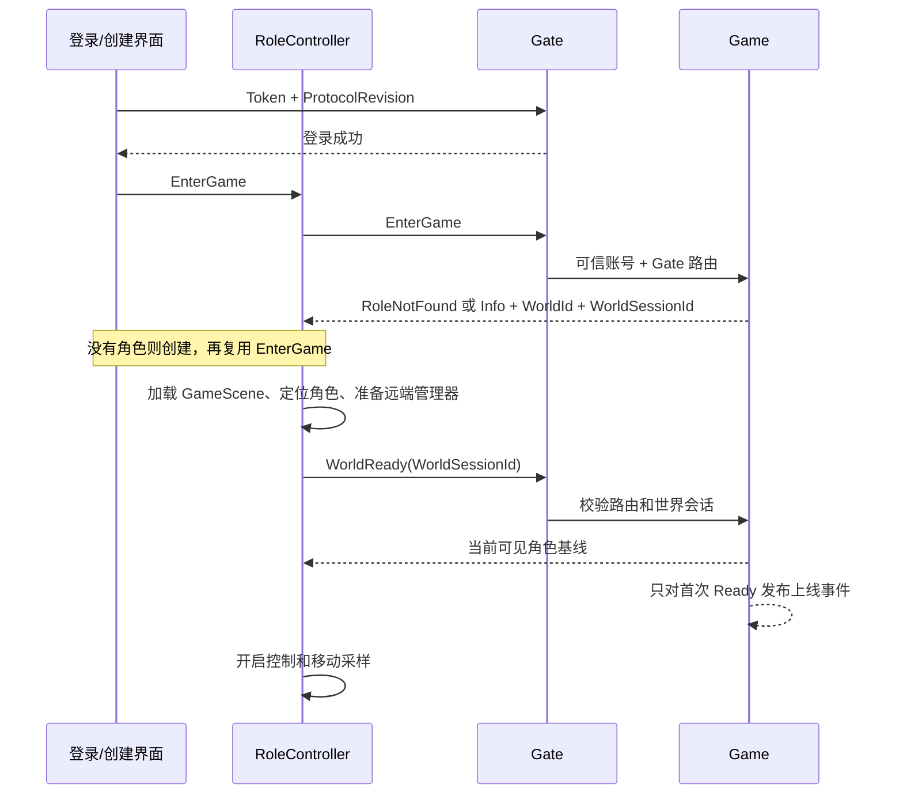

# 移动同步审查与实现说明

审查日期：2026-10-15。范围：协议、鉴权到进场、移动同步、重连、角色持久化，以及 Unity MCP 实际运行。

## 2026-10-16 补充审查（协议版本 3）

本节记录本次新检查和修改；后文版本 2 的数据为上次验证记录。

**判断**：Authentication / Gate / Game、私有与公开 DTO、本地输入 / FSM / 控制器、复制与插值的边界已经合理，应继续保留。本次修复实际时序缺口，不以增加抽象层数量作为专业程度的标准。当前适合继续开发单世界移动原型；尚不满足完整商业 MMO 的发布条件。

### 本次修复

| 缺口 | 修改及职责边界 |
| --- | --- |
| 回正后，仍在途的旧坐标包可能重新修改确认位置 | 新增 MovementEpoch；Game 在拒绝时推进代次，客户端接收后带回该值。同代次按 Sequence 排序，旧代次不修改状态，只重发最近回正 |
| 回正消息丢失时缺少恢复契约 | 旧代次心跳收到同一代次的回正；重发不继续递增代次，客户端不重复传送。客户端不能自行推进 Game 的代次 |
| 随机 SpawnId 无法比较不同上线实例的新旧；单条离开记录不能覆盖多次重登 | 新增 SpawnRevision，由当前 Game 世界按上线顺序递增分配，贯穿角色基线、移动和离开。客户端 RemoteSpawnTracker 独立处理身份、顺序和离开状态 |
| 新实例移动早于上线到达时可能丢弃位置 | 提前记录新实例身份并缓存其移动，收到匹配上线后消费；旧基线不能覆盖更晚观察到的实例 |
| 场景装配前的缓存可能绕过身份检查 | 消费缓存时重新核对上线顺序，已离开的实例不能在初始化外观时复活 |
| Windows PowerShell 读取含中文的 UTF-8 无 BOM 联调脚本时解析失败 | Run.ps1 使用 UTF-8 BOM，并以 Windows PowerShell 解析器验证 |

MovementEpoch 从每次进场的 0 开始，仅 Game 可推进，采用 uint 回绕比较。AckSequence 表示触发该次回正的上行包；重发时保持不变。此机制隔离回正前的采样，仍然属于客户端位置校验，不是输入重放或服务器物理模拟。

SpawnRevision 从 Game 世界的在线容器分配，范围是当前 Game 实例。WorldSessionId 隔离接收方的世界，SpawnId 标识远端实例，SpawnRevision 比较实例先后，Version 比较实例内部移动。未来跨 Game 迁移时，需要重新建立世界会话或提供跨实例的有序分配器，不能直接比较不同 Game 的 SpawnRevision。客户端按当前世界已见角色保留最新顺序，断线后清空；后续 AOI 的同实例重新订阅还应引入可见性订阅代次。

协议源、生成文件、Gate 转发、Game 规则、客户端采样与表现均已一起修改。新增字段使用新编号，没有复用旧编号。版本 2 客户端会被 Gate 明确拒绝；两端、热更新程序集和资源需要同步发布。数据库持久字段保持兼容，新代次与上线顺序均不入库。

### 本次实际验证

- 服务端解决方案、Unity 客户端项目编译：均为 **0 错误、0 警告**。
- 规则回归：**24/24**。新增旧代次在途包、重复回正、伪造未来代次、代次回绕和多次重登后的迟到消息；真实 ProtoBuf 序列化覆盖新增字段。
- 隔离真实 TCP 联调：**4/4 场景**。新增代次拒绝、回正重发、确认新代次后恢复移动，以及重登后上线顺序递增。使用随机隔离 MongoDB 数据库，结束后删除。
- 本次开始时 MCP 服务只连接 TapGJ；已接入并明确选中 **MMO_RPG@668f3899dec538a7**，核对项目绝对路径及 Unity 6000.3.8f1。刷新后确认内存协议版本为 **3**，不是只检查磁盘源文件。
- MCP 检查 Init、Login、GameScene：**0 缺失脚本**；本地角色的 CharacterController、PlayerMovementSync、Animator、相机及 Move / Run / Jump 引用完整。
- 从 Init 启动，通过实际 UI 按钮注册、登录；无角色进入创建面板，创建后进入 GameScene。已有角色重登直接进入 GameScene，WorldReady 生效。
- Input System 注入实际输入，逐帧记录 **Idle、Move、Run、Jump、Fall**，奔跑峰值约 **6.5001 米/秒**。后台输入测试使用临时克隆设置及虚拟键盘，结束后恢复。
- 注入 **500 米**异常位移，客户端接收代次 **1** 的真实服务端回正，回到注入前位置，距离差 **0**。
- 独立 TCP 客户端上线后，Unity 创建含正确 SpawnRevision 的远端外观，外观不带本地输入；离线后远端外观移除。
- 在实际 RemotePlayerManager 中模拟新移动先到、旧上线 / 旧离开迟到及连续两次离开后的旧上线，确认当前实例未被替换，旧外观没有复活。
- 断线后世界数据清空；同一账号重登恢复最终位置，距离差 **0**，新世界移动代次重置为 **0**。
- 测试结束已停止临时服务端、删除隔离数据库、移除临时 MCP 连接脚本，并恢复到原来的 `Assets/_Recovery/0.unity`；未保存或覆盖场景资源。

未执行广域网压测、持续丢包测试或服务端地图碰撞验证。本次本机联调和模拟乱序不能替代这些测试。先前 GameScene 光照数据的版本及文件缺失警告仍需美术资源重新烘焙。

## 结论

项目已经具有工程化基础：Authentication / Gate / Game 的职责划分、私有与公开角色 DTO、独立的本地输入和 FSM、移动校验及定时保存都值得保留。本轮补齐世界生命周期、复制时钟和真实联调，形成可以继续扩展的移动同步基础。

当前方案仍由客户端计算位移，服务端校验采样后复制给其他玩家。它不能证明玩家没有穿墙、悬空或使用其他作弊手段，尚不足以作为竞技或有经济系统的 MMO 的完整商业发布方案。固定广播周期也不能代替 AOI 和容量测试。

## 本轮发现并修复的问题

| 问题 | 影响 | 处理 |
| --- | --- | --- |
| 进场仍引用已删除的 Scene Night | 登录或创建成功后无法正确加载场景 | 游戏场景映射集中到 GameWorldView，WorldId=1 对应 GameScene |
| EnterGame 同时承担读档和正式上线 | 加载中的角色提前出现，加载失败也占据世界 | Enter 只预备，客户端加载和装配后调用 WorldReady |
| 单一移动版本无法表达不同上线实例 | 离线实体重建后的低版本可能被旧外观拒绝 | WorldSessionId 隔离接收方世界；SpawnId 隔离远端上线实例 |
| 远端每帧追逐最新位置 | 网络到达抖动直接影响移动观感 | 使用服务端单调时间戳和 150ms 有界插值时间线 |
| 按最小间隔丢弃状态切换消息 | 突发状态和最后一次停止位置可能丢失 | Gate 令牌桶；客户端每 0.5 秒补发当前状态 |
| 每个合法上行包立即遍历广播 | 恶意发包放大复制负载，广播与校验耦合 | WorldReplication 每 50ms 统一复制最新状态 |
| 角色加载和持久化模块直接负责世界广播 | 后续加入 AOI、分区时修改范围过大 | OnlinePlayerSystem 负责数据；WorldReplication 负责可见性和复制 |
| 静止心跳也标脏角色 | 无意义数据库写入 | 只有持久化的位置或朝向改变才标脏 |
| 异步创建角色面板时连接失效 | 旧回调可能重新打开错误面板 | 显示前后核对 Session 运行时 ID |
| 两端协议不一致缺少明确反馈 | 旧客户端表现为静默失步 | Gate 校验 ProtocolRevision，明确返回 UnsupportedProtocol |
| 连接模块直接访问全局业务管理器 | 连接实现依赖 UI 启动层 | 启动层注入 Fantasy Scene，NetworkManager 只维护连接生命周期 |

## 进入世界的契约



- Gate 的请求身份始终来自已验签的登录身份，客户端不能指定账号或内部路由。
- 同一连接只能准备一个世界，重复 Enter 返回 Busy；相同世界的 Ready 可重试，不重复发布上线事件。
- 加载失败或就绪失败会断开当前 Gate，撤销占位；旧异步结果不能关闭后来建立的新连接。
- 断线事件清空本人数据、世界标识和远端缓存，并停用本地控制。
- 服务端离线通知同时核对原 Gate 路由及世界会话，旧连接不能清除新连接。

## 同步边界

| 标识 | 生命周期 | 作用 |
| --- | --- | --- |
| RoleId | 持久角色 | 角色身份 |
| GateSessionRuntimeId | 一次连接 | 内部可信连接路由 |
| WorldSessionId | 一次进场 | 校验上行及接收方世界消息，防止跨进场污染 |
| SpawnId | 远端的一次上线实例 | 当前值取玩家的 WorldSessionId；跨实例重建外观与时间线 |
| Sequence | 当前 Gate 连接 | 上行防重放和乱序，支持 uint 回绕 |
| Version | 当前上线实例的移动状态 | 下行防旧包，不能跨 SpawnId 比较 |
| ServerTimeMs | Game 所在进程的单调时钟 | 远端播放排序；不与客户端日历时间直接比较 |

移动链路：本地输入 → FSM / CharacterController → 采样 → Gate 身份和限频 → Game 规则 → 内存状态 → WorldReplication → 远端时间线 / Animator。

本人回正走独立协议，按 WorldSessionId 与 AckSequence 过滤。远端只复制外观，没有本地输入或移动控制器。网络协议对象在回调内复制，避免把对象池对象留给后续帧使用。

默认发送变化间隔 100ms，状态变化可立即发送，静止补发间隔 500ms。Gate 允许容量 5 的突发，每秒恢复 50 个转发额度。Game 的复制周期为 50ms，同一周期只取最后确认状态；这不是服务端物理模拟 tick。

远端缓冲上限 32 个样本，默认播放延迟 150ms。按服务端时间插值位置、最短角度和速度；没有后续数据时停在最后确认位置，不无限外推。更换 SpawnId、传送或重建外观时清空旧时间线。

服务端保留有限数值、世界坐标范围、状态、报告速度、水平和垂直位移预算检查。非法移动不修改已确认位置，并给本人回正。静止心跳不写数据库；移动中的定时保存和正常断线保存继续使用原账号锁。

## 验证与复现

```powershell
dotnet build Server/Server.sln
dotnet build Client/MMO_RPG/Assembly-CSharp.csproj
dotnet run --project Server/Tests/Regression/Regression.csproj --no-build
powershell -NoProfile -ExecutionPolicy Bypass -File Server/Tests/Integration/Run.ps1
```

规则回归：22/22 通过。涵盖协议 DTO 与真实序列化、持久化边界、位移预算、非法数值、序号回绕、密码与 Token、世界就绪、跨进场回正过滤、限频和快照插值。

真实网络集成：4/4 场景通过。使用真实 TCP、生成的 ProtoBuf 协议、本机 MongoDB 及 Authentication / Gate / Game；覆盖加载不可见、Ready 幂等、角色基线、移动广播、瞬移回正、旧包和错误世界标识拒绝、断线保存恢复、顶号后的旧权限撤销。

Run.ps1 会在临时目录复制服务端，创建 `fantasy_sync_review_<随机标识>` 数据库。只在本机回环地址运行，结束后关闭测试服务端、删除该隔离数据库，日志保留在临时目录。测试前关闭占用项目端口的开发服务端。

Unity MCP 实际验证：

- Unity 6000.3.8f1，连接到当前 MMO_RPG 项目；脚本编译无错误。
- Init → Login，实际通过登录/注册面板按钮执行注册和登录。
- 新账号进入创建角色面板，创建后进入 GameScene；已有角色登录直接进入 GameScene。
- GameScene、Login、Init 无缺失脚本，角色的控制器、同步器、输入和模型引用完整。
- 通过 Input System 注入实际输入，观察到 Move、Run、Jump、Fall、Idle；实测奔跑峰值约 6.5 米/秒。
- 独立网络客户端移动时，Unity 创建远端外观，远端没有 PlayerInputSource；客户端离线后外观移除。
- 本地注入 500 米异常位移后，服务端回正到原位置，实测距离差为 0。
- 断线后世界数据清空；同一账号重新登录恢复最终位置。
- 当前未保存的编辑场景保留并恢复；没有保存或覆盖用户场景内容。

GameScene 原有 LightingData 存在 Unity 版本不兼容和部分文件缺失警告，需要重新烘焙；本轮没有重做美术光照。

## 面向商业发布仍需完成的工作

1. **服务端权威移动与碰撞**：客户端提交输入或移动意图，Game 按固定步长模拟；共享地图碰撞/导航数据，再加入本地预测、确认和重放。不能只把现有位置校验改名为权威模拟。
2. **AOI 与容量指标**：维护可见订阅及进入/离开差集，避免全场景 O(N²) 复制；对目标在线数测试带宽、复制周期耗时、GC 和队列积压。当前不能承诺任何商用在线容量。
3. **异常网络测试**：除本机实测外，还需覆盖持续延迟、抖动、断流、丢包、进程重启及多机部署。当前没有宣称完成广域网或 KCP 外网验证。
4. **持久化保障**：增加账号/角色唯一索引、脏数据版本统一管理、优雅停服排空和故障恢复。当前移动自动保存间隔为五秒，异常进程退出仍可能丢失最后一个保存周期的数据。
5. **运维与安全**：加密传输、账号/IP 请求总量限制、配置化接入地址、结构化日志和指标、告警及发布回滚。现有 Token 与速度校验不能代替这些能力。
6. **外观与世界配置**：当前远端复用本地外观作为单角色原型模板；增加职业、装备、不同模型或多地图前，需独立外观资源提供者与世界配置表。

协议版本已升级为 2。客户端、服务端、热更新程序集与资源应一起更新；旧客户端会收到版本不匹配提示，需要重新登录。现有账号和角色的数据库字段保持兼容。
